+++
date = '2026-09-28T00:00:00+09:00'
draft = false
title = 'タクティクスオウガリボーン第一章'
summary = "シナリオ感想中心の雑記"
+++

# はじめに
一定期間（半年～一年）に一回くらいTactics Ogre Rebornをやって満足する。今まで感想を書いたことはないが今回書きたくなった。

## 環境
前回（2026年4月プレイ時）から「TOR Micro Overhaul」というmodを導入した。ゲームは大抵そのままするタイプなのだが、良いmodだと思って導入した。modの詳細については紹介をしているサイトや配布ページに書いてあるため記述しないが、おそらくはSFCタクティクスオウガファンが期待していたであろう難易度に近い形（正面から殴ろうとするとそれなりの確率で避けられる）であり、バグフィックスもしてあるありがたいものである。

試しにボイスなし・キーボード＋マウス操作にしてみる。視点変更をしようとして右クリック押しっぱなしでマウス移動というありがちな操作をしたが残念ながら【J】キー（左回転）と【L】キー（右回転）、ズームは【I】キー（ズームイン）と【K】キー（ズームアウト）だった。少しコントローラーに戻したくなってくる。

## 開始
デニムを動かして次へ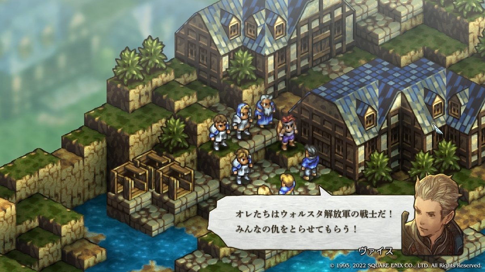ヴァイスはこの段階では解放軍の戦士というイメージではないためキャラクター付け（「戦士」「仇」という強い言葉を使って自分を奮い立たせている、そう見せている等）の一部なのかもしれない。

ここで操作性として思うこと
・カチュアが喋ってる最中にカチュアの発言を巻き戻すことはできるが別人の発言までは巻き戻せない。
・巻き戻しはコントローラーならボタン＋十字キー、キーマウなら吹き出しにカーソルを合わせてホイールの上下操作で行う。どちらの操作方法も、説明を見ないと分かりづらい。
・ウォーレンリポートなど開いた状態から戻る動作をESCキーで行えない。

ゲーム的に最初にやること
・カオスフレームの都合上、ゴリアテでバルバウダ人汎用ユニットを8名雇用、初期配属されたウォルスタ人汎用ユニット5名を除名する
・アルモリカ城に戻ってアイテムの購入を行う
・演習を3回行う（デニム＋汎用5～6名をレベル5へ、汎用2名はレベル1のまま予備としてストック）
・デニムはルーンフェンサーでレベルを上げる（終盤でMP全快アイテムを使ってスキルを連打することがあるため、ある程度の最大MPを確保したい）
ここらへんでキーマウ操作がきつくなってきたのでコントローラへ戻すことにし、オプション-操作設定-ボタン割り当てでAとBを逆にする。

## タインマウスの丘
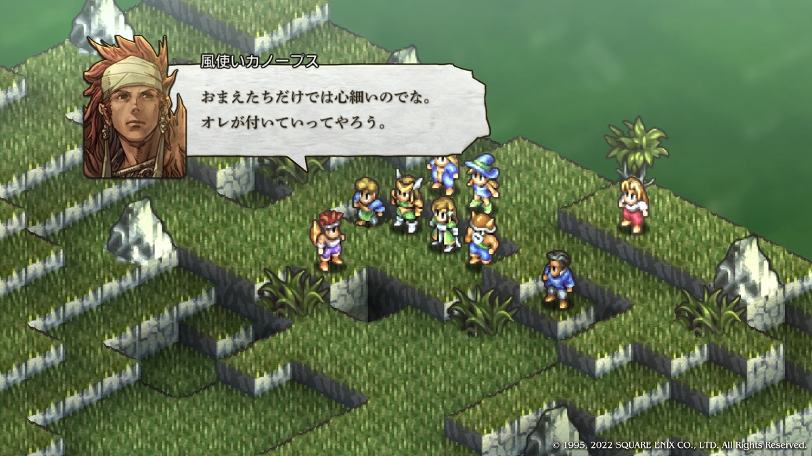ボイスなし設定なのに、カノープスの声が脳内で自然に再生される。

序盤の僧侶は
- HP回復の利便性が消耗品の回復アイテム＞回復魔法
- 除霊の利便性がイクソシズム＞聖水
- 状態異常回復の利便性がクリアランス＞回復アイテム

そのため、アンデッドがいないうえ状態異常も発生しない環境では、僧侶はやや空気気味になる。ルーンフェンサーでレベリングしたホークマン僧侶が死者の宮殿で活躍することもあるが、これは終盤の話である。

序盤の魔法使いは
- 攻撃魔法の使い勝手が微妙（投射型は射線が必要、放射型はMP消費がかなり多い等）
- 状態異常が効果的

序盤の攻撃魔法のダメージは、他職の通常攻撃（MP不要）と大差なく、魔法のほうが有利な状況もあるかもしれないが、分かりやすく他職以上のダメージソースになる魔法（シルフィードやノーム等）を得るのは終盤である。そして敵へ状態異常を付与することで味方の被害を減らすことのほうが、攻撃魔法によるダメージより戦局に寄与しているように見える。これらの理由から、ダメージソースとしての性能向上や運用は後回しになりやすい。  
ゲームバランスとしては正しい気がするが過去に僧侶をヒーラーとして使っていた層や魔法使いをダメージソースのメインとして使っていた層からすると少し残念なのかもしれない。ちなみに私は得意武器モーションがない点とランスロットのオルゴールがSFCと違う点が少し残念だな、という程度の懐古的なものである。

このマップで出てきたものとして
- 最も議論されたであろうバフカード
- レア堀りがだるいことへの救済として許容されていそうなC.H.A.R.I.O.T.
- 存在意義が見えてこず、面倒くさいだけのボーナスタスク

レア装備（個性を薄めてしまうウイングブーツ等）をなくしてC.H.A.R.I.O.T.もなくせば難易度としては面白そうだが現実的には無理そうだ。

ここまで一見不満に見えそうな点も書いてきたが、このゲームは面白くてやる価値があるものだと思っている。

## クリザローの町
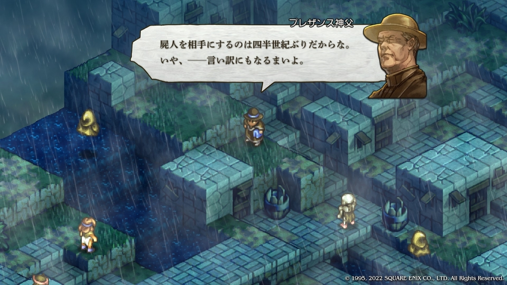なんとなくメタ的だと感じてしまう。  
※タクティクスオウガは1995年発売かつプレザンス神父は当時のシステム通りではあるが登場時、アンデットを戦闘不能にせずにそのままイクソシズムで除霊していた。

クリア後の選択肢は以下のようになる。
1. アルモリカ城へ引き返す
2. そのままクァドリガ砦へ
3. ユニオンレベルが上がってるので演習でレベルを上げてからクァドリガ砦へ
4. 実はアルモリカ城に一度引き返してからクァドリガ砦へ行くこともできる

ちなみに4.でレオナールを出そうとするとこうなる。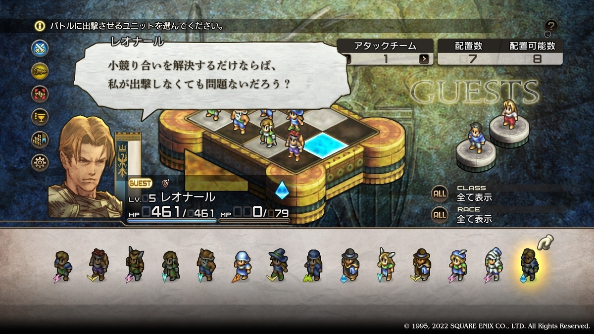3.を選択して出撃予定のメンバーをレベル8にする。この段階でも手動の演習であるため少し面倒である。

## クァドリガ砦
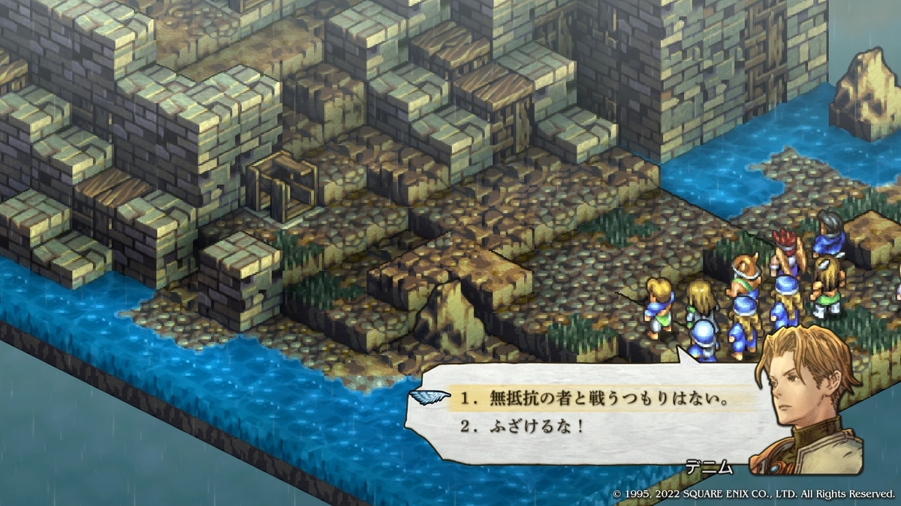「無抵抗の者と戦うつもりはない。」理性的な台詞ではあるけど、城に戻れる状況で損害が出る可能性がある場所に来るのは理性的ではない気がする。そして「ふざけるな！」はそんな感じだったっけ？になる。

前口上が終わったところで状況は
- 自軍より高火力の魔法が定期的に飛んでくる
- 高所の利を取られている
- アンデッド多数
- 数を減らしても補充される

即時撤退が推奨される状況である。

攻略法は色々あるかもしれないが下記の様な感じにする。レベル8まで上げてあればそんなに運も絡まないでしょーとか甘く見ている。
- 一撃が痛い魔法が飛んでくるならHPを高めに維持する。削られたらすぐ下がる
- 高所の利を取られているなら接近するか誘い出す
- イクソシズム要員を2名に増やしHP回復はほぼアイテムで行う
- 補充を行えばその分攻撃魔法が減るし前衛が減っているだろうからなんらかの攻撃がニバスに届く、かもしれない

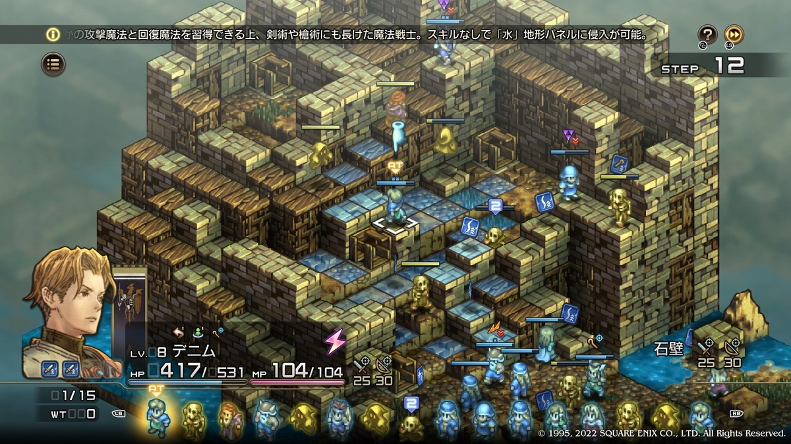
色々書いた割に序盤に運良く直接攻撃力のバフカードを2枚拾ったデニムが運良くニバスに接近できてしまい運良くその後も危なげなく終わってしまい運悪く書くことがない。

アルモリカ城へ帰ったら公爵の指示で密使のような任務を果たすためにフィダック城へ向かうこととなる。さらに資金も渡される。納得いかない部分はあるが、資金を渡してくれるだけ公爵は良いリーダーにも見える。

5000ゴートもらってもスタメン全員の装備を更新できる状況でもないため、スレンダースピア1本（デニム用）とバトルアックス1本（カノープス用）と消耗品を多めに補給したら出発である。

## ゴルボルザ平原
デニムにアタックターンがまわってきたところでAIコマンドが使用可能になる。演習で放置してレベリング用にしか使われない場合もあるが人間が簡単には思いつかない選択肢を教えてくれることもある。

敵リーダーのブレッゼンが直接攻撃力のバフカードを2枚拾い、こちらのルーンフェンサーを殴って後退させるという珍しいことも起きたがそれでも戦力差は埋まらない。

あっさり勝利したがボーナスタスクのアーチャーを忘れていたのでやり直してみる。そして結局あっさり勝利する。自軍がLV8で敵軍はLV5（ブレッゼンだけLV6）で人数もこちらの方が多い、ほぼ障害物のない平地となれば仮にLV5同士だったとしても人数差は厳しいしmodのサイドを取った方が有利という仕様が拍車をかけている。

最初に逃げ腰の部下を殺し、戦いは数だけで決まらないと発言したブレッゼンだが「自分が死ぬことは薄々分かっていたんじゃないか？」とも思わせるような雰囲気だったりもする。ウォーレンリポートの設定を見ると無能指揮官というよりは仲間に恵まれなかった死にたがりの元剣奴に見えなくもない。

## 古都ライム
大抵の人が最初の選択肢「いずれにせよ放ってはおけない。」を選び、システィーナが死ぬとゲームオーバーになるため「メインヒロインかなにかか？」と勘違いしても仕方がない戦闘である。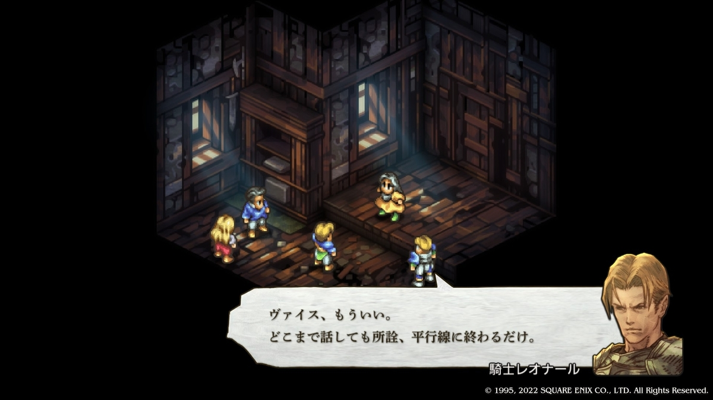戦いが終わったあとに話があるが、戦時の議論はこれに尽きる。

## フィダック城
ユニオンレベルが11になり出発する、伏線のある会話や選択肢をこなして帰途につく。

ランスロット・タルタロスの「汚い仕事は～」という台詞、一章のタイトル「僕にその手を汚せというのか」とかなにかと手を汚すことについての物言いが多い。（誰かの心情を映しているかのような錯覚を覚えさせる）

私の妄想にすぎないが「手を汚す者がいるから成立している物事がある」と考えている人にとって感情移入しやすい作りに見えなくもない。

## アルモリカ城
NPCのレオナールが抜け、ラヴィニスが戦闘に参加する。しかしこの時点ではカノープスが主体の電撃戦が一番効果的なのに対しレオナールやラヴィニスは後詰めかそもそもイレギュラーの発生源と見なして使わない（最初に味方で攻撃して撤退させる）感じになるので、話の流れやNPCだから仕方ないとは言え操作できない上に汎用ユニットより少し強いくらいの騎士（ヴァルキリー）一名の援護を与えられたことになる。レオナールの時は書簡持ちでまだ分かるがラヴィニスは「代わりにグリフォン一体与えた方がマシなのでは」と言われてしまいそうな状況である。

SFC版ではいなかったこともありやや唐突な援護に見える。ただ、ラヴィニスの設定を踏まえると、ロンウェー公爵が「従わなかったらレオナールに片付けさせるためにデニムに同行させよう」と考えていた可能性もありそうだし、以前読んだ考察でもそのような指摘があった気もする。

店に新しい武器が入ったと表示されはするもののスタメン全員の装備を更新できる状況でもない（同じ展開）、武器を購入する前に序盤は下記のようになる

- ウォリアーはマイティインパクトがあり使える武器種も多く何かと自由度が高い
- アーチャーは使いやすいが弓、弩攻撃が通らない相手に空気
- 魔法使いは状態異常付与が非常に強いがそれ以外の要素が微妙
- 僧侶はアンデッドがいないと空気気味
- ヴァルキリーはヒール、攻撃魔法、槍が使えて装備効果なしに水に入れる
- ナイトはヒールも使えるしタンクにしては自由度が高い
- バーサーカーは単純に強いしバーサークも強いけど裏目にでることもある
- ビーストテイマーはアイテムスリングだけでもスタメン可に近い

これらを念頭に置いて部隊を再編し、AIコマンドを使って演習を行う。（「システムコマンド-オプション-プレイ設定-バトルメッセージを自動化」をON）  
※書くのを忘れていたがどこかのマップでサブコマンド-現HP簡易表示をONにしてある。

このゲームの戦略、戦術、戦技を知っていれば何かができていなくてもクリアはできる。演習や装備更新（戦略）を余りせずに拾った装備中心で話を進めること等もできなくはない。しかしそれでは書くことがどんどん減って行く。発売当初もそうだったが極端な話Lユニットと消費アイテムを活用することで大抵の縛りを突破することや短時間や少ないゲーム内日数で攻略はできてしまうし、他にも色々なことが多種多様な方法で実現可能だろう。modで位置取りを強制されることで得られる充実感も、結局は縛りプレイで得られる充実感と大差ないだろう。つまり私にとって分からない何かが何度やっても飽きないことの原因のようだ。

というわけで、ヴォウジェ1本とツヴァイハンダー1本を購入。さらにキュアシードとキュアペーストを残金で5個ずつ買い、装備させて出発する。

ストーリー（奇襲されても敵将を討とうとする）を知っている観測者の立場からすると、信じがたい台詞である。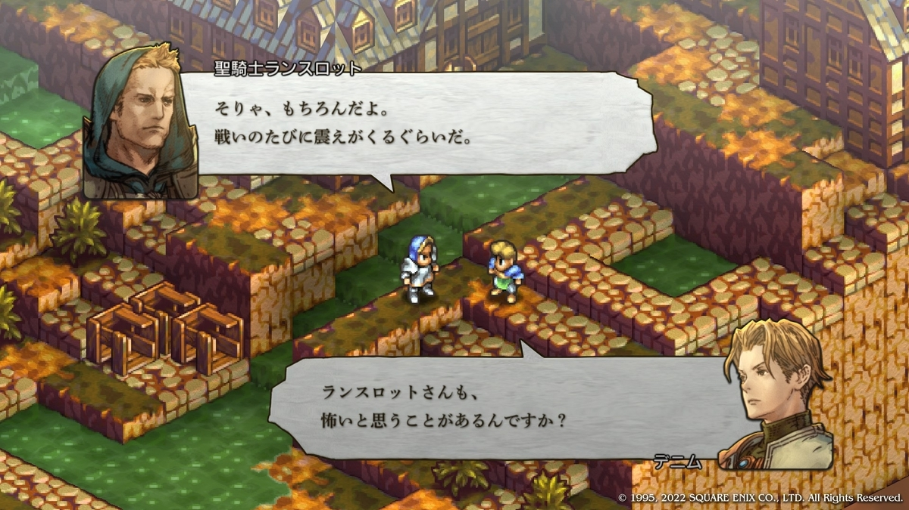

## ボルデュー湖畔
レクセンテールの声（演技がそう感じさせているのかもしれない）が結構渋かったような気がするが詳細を覚えていない。敵はマイティインパクトを使うことができずこちらは使うことができ、使用するためのMPは時間経過で増えていく、ついでに敵にはHP回復アイテムもないのだから戦いが長引けば自軍が有利になる、相手が運良く強いカードをたくさん拾って速攻を仕掛けるなんてことがなければ、ではあるが。

当然のように勝利し拾った装備で自軍を強化する。

## ゾード湿原
ホークマンがドロップする飛翔者の証を拾いたい。つまりホークマン2体を倒すまで撤退させない（ベルダ、オブダ、ガンプの攻撃が自由である）ということになる。ガンプは接敵まで時間があるし足止めできるがベルダ、オブダがあからさまにきつい、防御性能が低い味方をいくら回復しても死ぬまで2体で攻撃し続ける（味方キャラを置いてもナミングフックしてくる）のが容易に想像できる。

更にこのマップで説得して仲間を増やそうとか入れ始めると本当にきつくなるのでとりあえずそういうのは別途行う。

近接だけ出して（ボーナスタスクはヴァルキリーの魔法で行う）
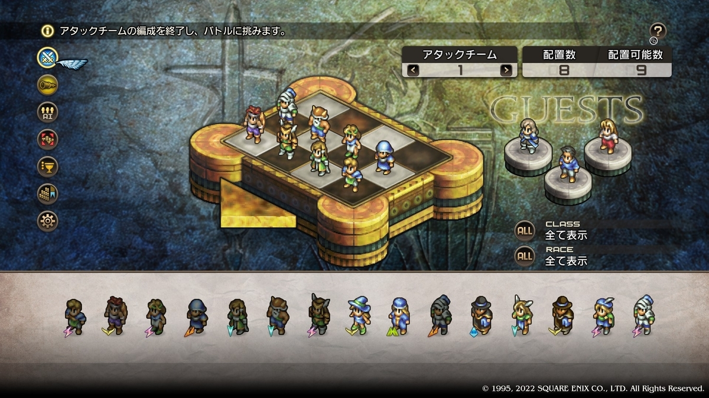片翼から潰して
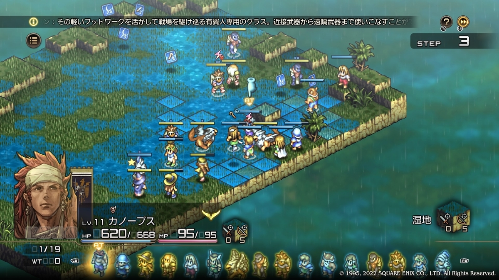ベルダ、オブダ、ガンプ以外を倒してから撤退させる
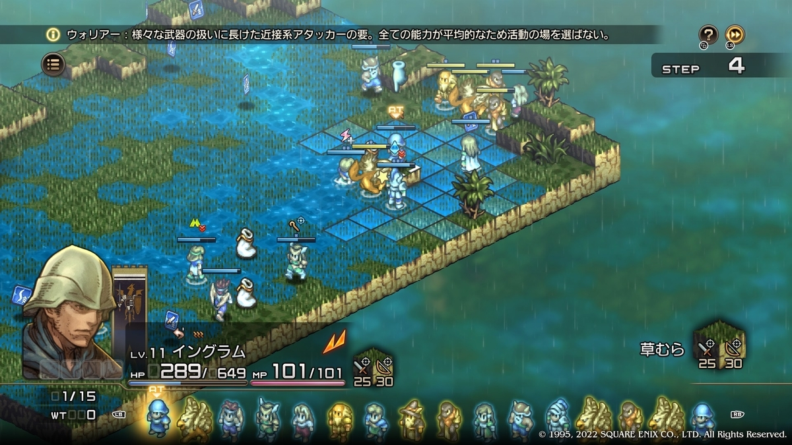格闘用ウォリアーがグリフォンにナミングフックされたら格闘の武器学スキルのレベルが上がるという珍しい？体験をして終わる。アンデッドを囮にするとか他にも色々方法はありそう。

## バルマムッサの町
ファンなら何度来たのか分からない選択の地である。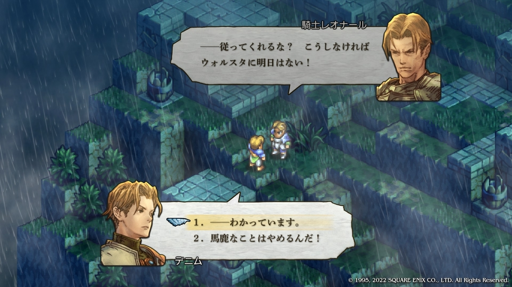少年時代、予備知識なしでこの選択に出会い、衝撃を受けた。その時は2を選んだような気がするがなぜだったのだろうか、「こんな形で犠牲を出すことは認められない」とか考えていたかもしれないし、何も考えずに選んだかもしれない。思い出すことはできない。

仮にこれをしなければ民族浄化で自民族が消滅することが確定するのだとしたら、自身や周りの人間が数年以内に全員殺されることが確定するのならば、といった思考をした上でも2を選んだ、という可能性は低い。
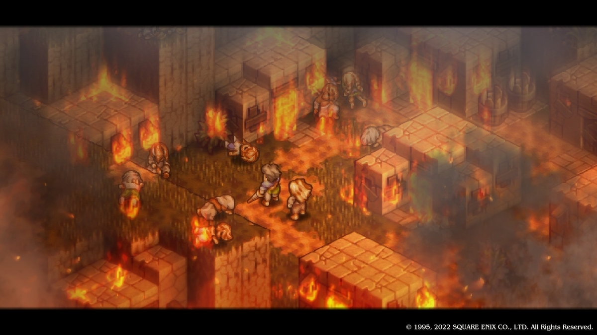
