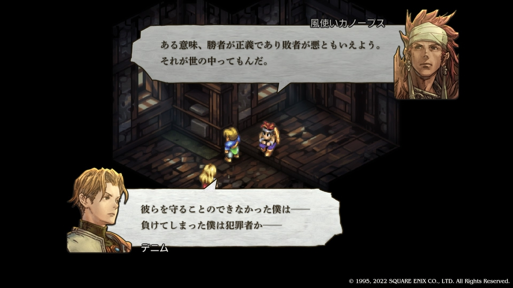
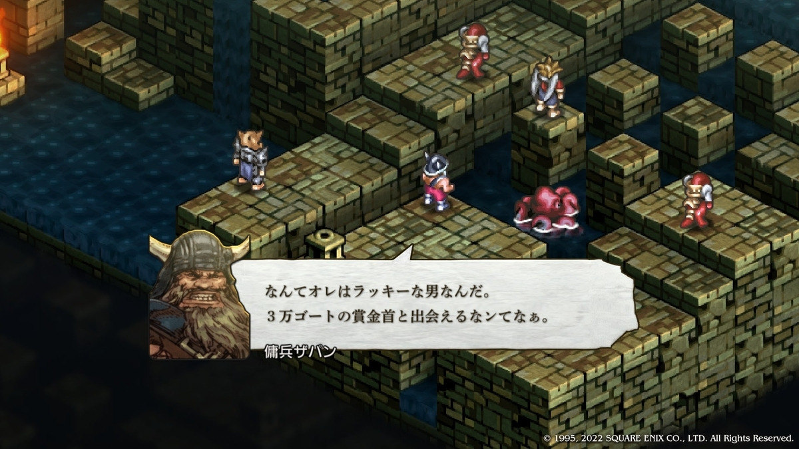
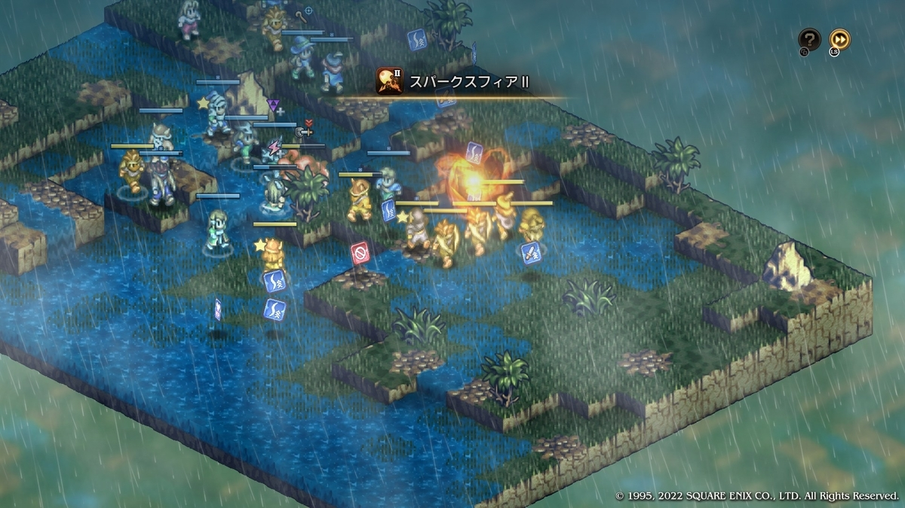
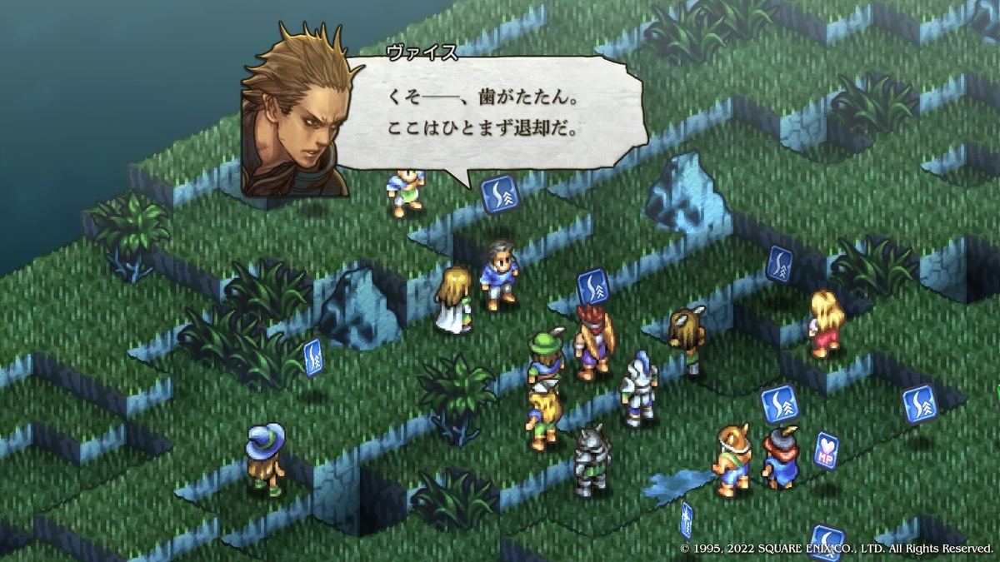
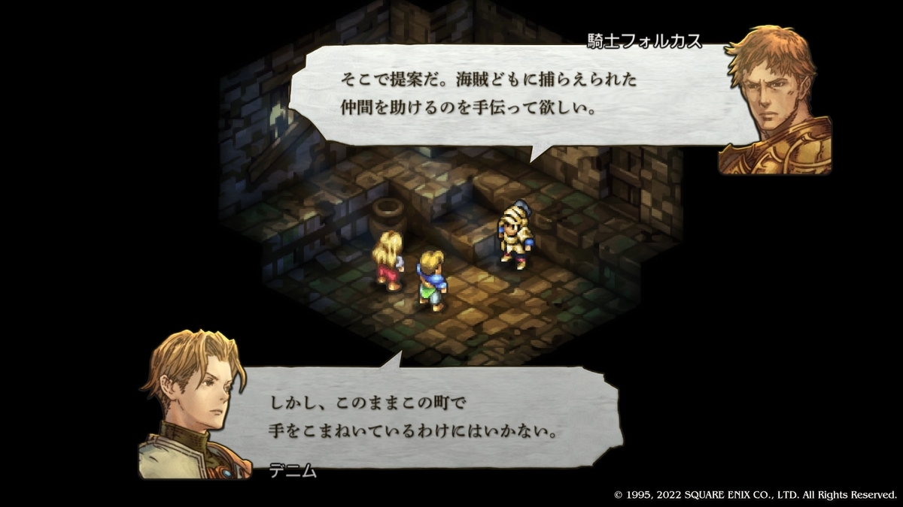
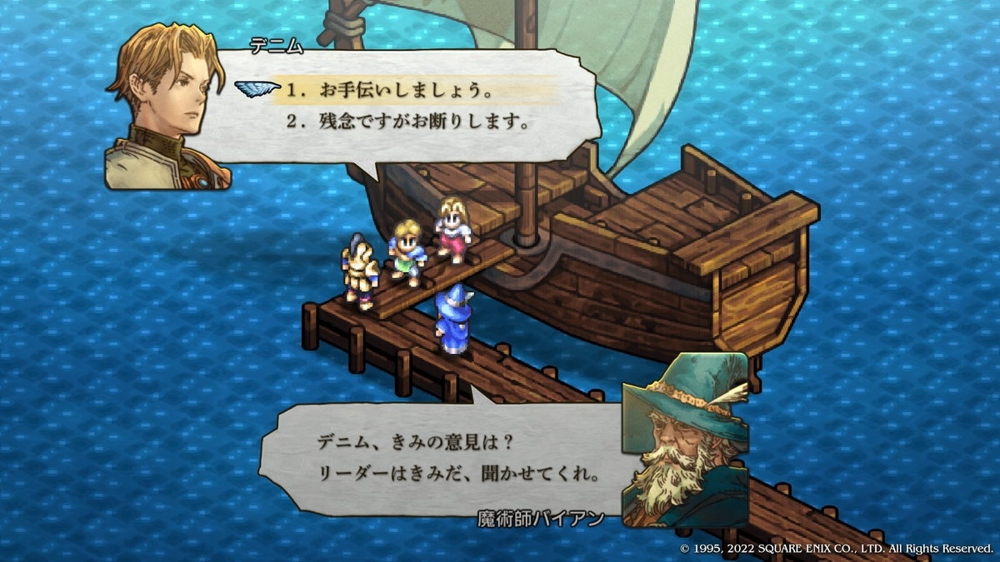
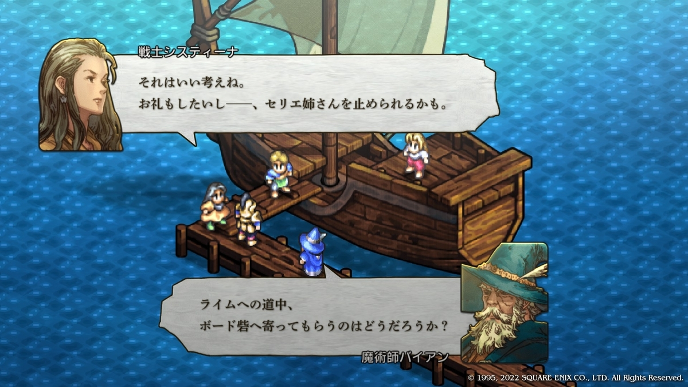
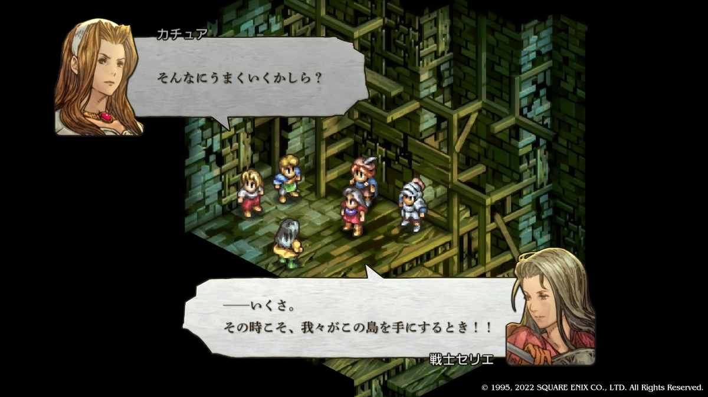
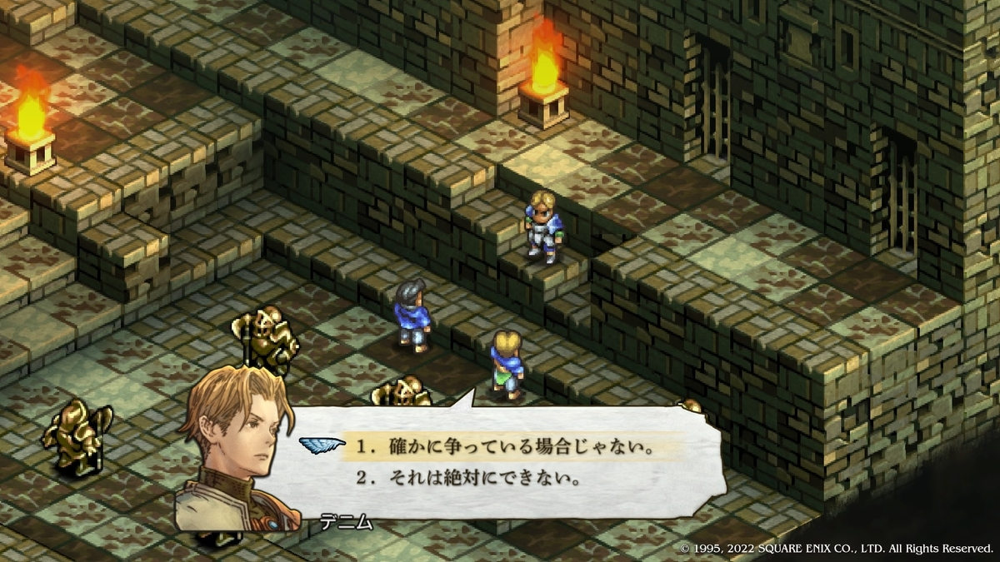

+++
date = '2026-10-05T00:00:00+09:00'
draft = false
title = 'タクティクスオウガリボーン第二章'
summary = "攻略記事に非ず、シナリオ感想中心の雑記"
+++

1章末でデニムはバルマムッサ住民の虐殺を拒み、抵抗した。

しかし住民を守ることはできず、敗北する。
その結果「汚れた英雄」という、昔の小説の題名のような称号が与えられた。

## 港町アシュトン

開幕時ショップも演習も利用できるが、町を出ようとするとアロセール隊との戦闘が発生する。アロセールは高所を取り、自分の部隊だけで戦闘を開始した。ここで一度、ゲームであることを忘れてみよう。

すると「彼女は本気で倒せると思っていたのだろうか」という疑問が浮かぶ。英雄と称される人物の部隊に自分の擁する部隊だけで挑むのは、戦術として勝ち筋が薄い。もし「本気で仇を討ちたい（ほぼ確定で勝利する見込みを得る）」なら、手段を選ばないはずだし、高所を取っただけでなんとかなると思うような経歴でもない。それなのに、彼女の行動はどこか中途半端に見える。最初から死ぬつもりだったのでは、と疑われるような1章のブレッゼンと比べると、違和感を覚える。

自身の窮地とはいえ、目の前に仇がいる状況で「さあ、私を殺しなさい」と言うだろうか。本気で仇を討つつもりなら、最後の一瞬まで諦めないのではないだろうか。これらのせいでアロセールはどこか噛み合っていないように見えてしまう。

## リィ・ブム水道
向かうとザパンと遭遇する。狭い通路に詰まったところへバーサークしたザパンが突っ込んでくる展開はよくできていたが、部隊の配置と構成がそこまで厳しくなかったため、時間をかけて削り撤退させた。

ザパンは敵でありながらどこか憎めない。金という一貫した価値観を持ち、悪党ヅラと言われても笑い飛ばす。分かりやすくタフガイで、味方なら頼もしすぎるほどの存在だ。

ウォーレンレポートでは悪評が並ぶが、それでも「頼れる男」のイメージが強い。

## ゾード湿原
孤立したアロセールがおり、彼女を援護する形でガルガスタンと戦うことになる。

晴天の湿原で、離れた位置にアロセールという囮がいる。負ける要素がないので蹴散らして終わる。

アロセールの発言について気になった点を挙げる。

「私を捕虜にしようというのか？」

→アシュトンでアロセールが戦意を失った際、デニムに「立ち去るがいい」と見逃されている。その経験があるのに、なぜ捕虜という発想になるのか。

「確固たる証拠が欲しい」

→証拠なしで仇討ちをしようとした人物が言う台詞ではない。

アロセールの言動は設定上の行動原理と噛み合っていないように見える。このあとのストーリー（ヴァイスの言動から虐殺の事実を読み取りデニムの無実を確信する流れ）のためなのかもしれないが、それにしても厳しい。

## 部隊の再編
キャラクター考察から離れ、ゲームの進行に目を移すと、防具は拾い物でほぼ整い、HP回復アイテムの在庫だけが少し不安という状況になっていた。
町に戻って回復アイテムを補充する。ついでにソニックブレイドを覚えた両手剣ウォリアーを、ツヴァイハンダー+1でテラーインパクト攻撃という小技で活用できるテラーナイトへ転職させる。戦略上の意味は薄い「趣味行動」である。

ここでふと「そろそろ合成レシピが買えるのでは」と思い確認すると、販売されていたので購入する。
プールしていた資金と不用品の処分で余裕が生まれたため、以下の優先度で装備を更新した。
1. 電撃作戦が多いことから、移動に関わる腕と下半身を+1品へ強化
2. 貼り付いて守ることができない後衛のため、防人の指輪+1を追加
3. 戦闘頻度の高いキャラ（カノープス等）から武器を+1品へ強化

演習（オートとはいえ時間を強さへ変換する行為）によって戦力に余裕が生まれ、装備にそこまで注力せずとも行動できるようになり、結果として資金がプールされる。その資金で装備を更新し、さらに戦闘に余裕が生まれる。この循環が私に一定の充実感を与える。

部隊の再編・装備の強化を進めていくと、ちょうど有り金を使い果たした頃に、スタメンの武器がすべて最適化されていた。
結果として、戦力と資源のバランスが自然に整った形になる。

## ボルデュー湖畔
雨天で移動が制限された状況の中、NPCがホークマン2名を背後に回し挟撃するという、見事な戦術を取ってきた。

その後もバフカードを拾い続け、NPC側が有利を取る展開が続く。本来ならNPCの勝利が見えてくる状況である。しかし自軍は装備を強化しており、NPCはそうではない。使える回復アイテムにも大きな差がある。NPCは戦術的には優位だったが、プレイヤー側だけが持つ戦略的リソース差によって勝利には届かない。

開幕のやり取りで「人種間の溝が大きいことの表現」があるくらいで特筆することがなさそうなマップだったが、戦術と戦略の差が分かりやすく表れるという、興味深い結果が得られた。
なお、この記事では戦略を「装備・資金・部隊編成」、戦術を「戦闘中の判断」として使っている。

## タインマウスの丘
開幕と戦闘中にヴァイスとのやり取りが入る。
「プロパガンダとしての虐殺。その真相を知る者を消す」という、組織としては当然の行動を、彼は悪役らしい言い回しで告げてくる。
戦闘中のヴァイスは妙にキレのある指摘を続け、先に発言したカチュアとアロセールが黙ってしまうほどだ。

引き際もわきまえている。この「悪役としてのヴァイス」は、物語として見れば整合性があり、悪くない。

戦闘が終わりアロセールが加入する。ヴァイスからアロセールへの「キレのある指摘」の内容は
アロセール「虐殺を隠し通せると思っているのか？人は真実を求めている。」
ヴァイス「人は"信じたいこと"を"真実"だと思い込んで納得しているだけであり、事実お前（アロセール）もそうだった」

このやり取りに対し、アロセールは反論できなかった（もしくはしなかった）。ヴァイスの指摘は辛辣だが、アロセールは恋人レオナールから虚偽の虐殺の内容を聞かされ、それを信じ、命令を無視して自分の部隊単独でデニムを殺そうとしていた。これをプレイヤーにも見せている。

仕方のない部分もあるかもしれないが、このような人物を一兵卒だとしても、二つ名がつくほどの人物だとしても、話の流れだけで安易に自軍に編入できるか？と思ってしまう。お人好し設定のデニムだとしても整合性が取れるか怪しい。

ここまで書いていて思うが、私はアロセールに少々厳しすぎるのかもしれない。アロセールはSFC時代のTOでとても強く、TORでもそれなりに強い。性能面の強さのせいで設定面に対して厳しくなってしまっている部分はあるし、幼少期に活躍させていた思い入れのあるキャラクターに対する反動であるかもしれない。

ワールドマップに戻りニュースを確認すると、フランパ大森林が開放される。
これまでのようにリソースが限られた状況とは違い、自由に何度も稼ぎに行けるマップが得られた。
ホークマンやグリフォン、ドラゴンなどの仲間を増やしつつ、ゴートを稼ぐことができる。
戦力と資源の両面で、部隊の構造を大きく変えられる地点に到達したことになる。

## クリザローの町
ウォルスタ解放軍と出会う。こちらが派遣していない斥候を捕らえたと得意げに語る敵将ガナッシュ。要領を得ないまま戦闘が始まる。

自軍はカチュアを含め11名、敵も11名、こちらは近接8弓1魔1僧1、相手は近接7弓2魔2である。前々回のボルデュー湖畔と同様に装備と回復アイテムに差があり、水場の代わりに障害物が利用できる市街地戦となる。
- 障害物を利用できるので敵近接の攻撃が集中しにくい
- 汎用ユニットよりステータスの高いデニムとカノープス
- 回復行動しつつバフカードを集めたビーストテイマーが無傷で控える

上記により早々に埋まらない差が開く。敵主力のウォリアーが直接攻撃のバトルカードを二枚連続で拾い、マイティインパクトで誰かを戦闘不能にする。こういったものくらいしか事故原因がなく、それを把握しているため対策が可能である。よって負ける要素がない。被害が出ないよう慎重に戦うだけで順当に決着がつく。

戦闘終了後の会話パートで、カチュアは「弱みにつけこみ自軍にリスクを負わせる取引（目的地への輸送と、砦に陣取る海賊との戦闘及び人身の救出のトレード）が気に食わない」と発言し、それに対してデニムは「姉さんはなんでも気に入らないのさ。自分の思い通りにならないことはね」と返す。

カチュアの意見は言い方のせいで感情的に見えるが、リスクを考えれば普通である。この段階ではそれほど的外れでもない。また2章Cの章題は「思い通りにいかないのが世の中なんて割り切りたくないから」である。カチュアへの皮肉として成立しているようでいて、気に入らないことへ抵抗しているデニム自身に返ってくる言葉でもある。肉親相手ゆえの甘えなのか、それともデニムはこういった形での矛盾は察知できないのか、「やはり、君は幼い」というバルマムッサでのレオナールの言葉が思い出される。

## 部隊の再編
そのままクァトリガ砦へ向かってもいいが、今回はフランパ大森林で「ホークマンのルーンフェンサー2名、グリフォン2体」を味方に加えてから部隊の再編を行う。

ホークマンの名前はアーノルド、シルベスター。グリフォンの名前はガルーダ、スパルナにする。オフラインゲームのユニットなら元ネタがある名前を付けて愛着をもつのも悪くはない。

## クァトリガ砦
仕様が違うSFCのTOとは言え、幼き頃に何度も失敗してやり直したバイアン救出マップである。今となってはよほど下振れを引かない限り、いや引いたとしても恐らくは何重にもしかけた保険により不安なくバイアンを助けることができそうだ。（起きるかどうかは知らないが、初手バイアンがダッザへ直行し、そこでクリティカルカードを拾ったダッザがバーサーククリティカルを直撃させて一撃で即死とかだとさすがに無理ではある）

戦闘終了後の会話パートでバイアンに「システィーナの救助」を依頼される。

「お手伝いしましょう。」という選択肢が天丼ギャグだと言われても驚かない。あくまでゲームの主人公であり、お人好し設定だとしよう、断る選択肢も存在し、部隊員の忠誠度変動も小さいが起こる。一兵卒の立場なら、困っている人を見るたびに新たな問題へ首を突っ込み、気づけば別の戦いに参加しているような指揮官に不安を覚えても不思議ではない。こうして見ると、カチュアのリアクションは設定として自然に感じる。ただの口うるさい姉ではなく、弟のために真摯なリスク管理を行っているように見える。

## ダムサ砦
前回同様、バイアンを死なせないための戦いになる。味方側に配置されるので前回よりは楽だと考えがちだが、高低差で見ると低い位置から始まる上にアーチャーの射程内へ進んでいく。カモにされるのは目に見えているので何かしらの対策が必要になってくる（私の場合、あまり脅威ではない敵を安全な場所からバイアンが攻撃し続けるよう仕向けた）。

戦闘終了後の会話パート。前の二つの戦いに続き、今回もまた助けた相手から新たな問題の種が持ち込まれる。今までヴァイスに「僧侶くせに人を騙してもいいのかよ！」と言われ、デニムに「自分の思い通りにならないことは気に入らない」と返されるカチュア。だがカチュアは三度目の「それを断らない弟」を見てなお（不機嫌は少し出すが）怒らないでいられる。私はこの忍耐力を見習うべきかもしれない。

## 港町ゴリアテ
操作できない味方NPCが4名おり、そのうち3名は死亡する可能性がある。ただし、自陣から敵陣までの通路が狭く、一人に攻撃が集中しづらい。地形の関係で後衛が前に出ることも少なく、NPCに危険が及ぶ場面はあまりない。一方でグリフォンにとっては非常に戦いやすいマップでもある。奇襲しやすく、攻撃後の離脱もしやすい。ホークマンや後衛の援護があれば簡単に活躍できる。逆に飛行能力を持たない近接ユニットは通路で詰まりやすく、何もせずターンが終わることもある。ストーリー面で進展はないが、飛行ユニットの強さを再確認できるマップである。

## ボード砦
戦闘はないが話の内容は戦闘があるマップより多い。ヴァレリア解放戦線は登場人物によって評価が異なり、作中人物にも実態が掴みづらい組織として表現されているが、神視点を持つプレイヤーから見ても設定がよくわからない組織である。そのリーダーでありシスティーナの姉のセリエと出会い、デニムは「暗殺からの国盗りに参加しないか」と持ちかけられる。

ここまでだけだと「手段を選ばない実行力を備えていそうなリーダー」に見えるが、システィーナがその場からいなくなった途端に「妹は～」とシスティーナの人となりを説明し、自分が愛していることやデニムに力になってやってほしいことを伝えてくる。自分とは異なり理想しか見ていない妹、その妹をも気にかける優しい姉に見える。

Cルートのデニムとシスティーナは、理想はあるがその理想を実現するために自らのモラルを越えることができない。

## 古都ライム
飛行移動を重視するとその分被害が発生しやすく、軽視すると通路を塞がれ身動きが取りづらい、そんな配置でスタートすることになる。ストーリー表現ではなく戦闘での表現として「ザパンと単純に力比べで戦うのはやめておいたほうがいい」というものに見えるのも面白いところである。しかし戦闘を開始すると、想定とは違う形で有利となってしまう。
- カチュアが敵陣奥へ進み回復アイテムで耐える（ザパンが追っていって前線の被ダメージが大幅に減る）
- 準備が整ったドラグーンの前にドラゴンが出てきて1体目が即死、続いて2体目も同様に即死

これらの想定外の大きな有利により、ザパンがクリティカルカードを拾うなどの事故を回避するだけで勝てる状況になってしまった。つまらないのでやり直すと下記のようになった。
- 最序盤にカチュアは退場、敵味方が衝突する
- 恐怖デバフによるダメージの増加を利用し敵の数を減らす
- グリフォンで敵の行動を阻害、ドラグーンを敵ドラゴンへ進める
- 弓による麻痺でザパンからのダメージ、吹き矢の魅了で他の敵の行動を阻害する

一度ザパンのバーサーク攻撃が自軍複数に大きなダメージを負わせるが、それまでの有利により被害は発生せず勝利し、ゲームに満足した。

それなりに強い敵と相対した際に、敵は使ってこないが自分が使え、大きな有利を得られるアイテム（生贄の烙印や各種炸裂弾）を使うかどうかについて考えることがある。戦略を行い優位に立つことや、戦術を考え対抗することとは少し違う気がする。また、使わなくても他の手段で勝てそうな相手に対しては、あまり使う気が起きない。こういった仕様になった理由はわからないが、ゲームを楽しむ上で扱いが難しい部分となる。

戦闘終了と共に暗黒騎士団（バルパス、マルティムとその配下）が古都ライムへ侵攻、そのどさくさに紛れザパンがカチュアを捕らえて逃走する。その後、バルパスへ向かうランスロット、デニムを見つけたマルティムを遮るギルダスという二つの勇姿が表現される。

## アルモリカ城
移動時、コリタニ城に居るロンウェー公爵が「バルバトスもいなくなり、これで密約も不要になったということか？ええい、忌々しい！！」との発言が含まれたシーンが表示される。1章の「計略」ではロンウェー公爵自身が「ガルガスタンを倒したあとはバグラムも倒す」と語っていた。忌々しいという前述の発言は「計略」での発言と矛盾しているように見える。つまりセリエの発言した予想である「権力のためにブランタ（バクラム）とロンウェーは戦わず手を組もうとするだろう」という予想通り、ブランタについては分からないがロンウェーは戦う気がなかったことを示唆する表現が行われる（すぐに戦うつもりではなかった程度なら忌々しいまでにはならないだろうという私の想定も含まれる）。

## アルモリカ城城門前
敵リーダーラミドスの魔法はそれなりに痛い、そしてザパンという強力なバーサーカーもいる。一見厳しく見えるが前回と異なり、部隊は普通に配置されマップは広く平坦、障害物もない。つまりザパン以外はちょっと強い演習レベルなので適度な状態異常付与と各個撃破を行い、早めにザパンを撤退させたら勝利が確定する。本筋とは関係ないが「短兵急」という言葉をラミドスが使い、私はこのゲームでその言葉を初めて知った。まだまだ知らない日本語はいくらでもあるのだなと思うところである。

## アルモリカ城城内
感情的な台詞を繰り返すヴァイスとそれをとりなそうとするデニムで1対1の戦いが行われる。ヴァイスのHPをある程度削りデニムが勝ちそうなHP状況になった時、ゲームとしての戦闘が終わる。

レオナールが現れライムが陥落したこと、理想についてを話しはじめ、公爵軍へ戻ってこいと語りかけてくる。

1章と同様に選択する時間である。

