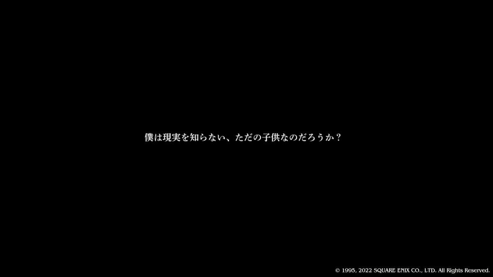
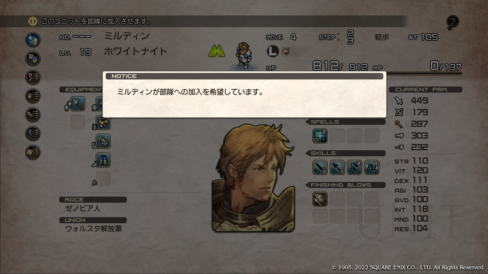
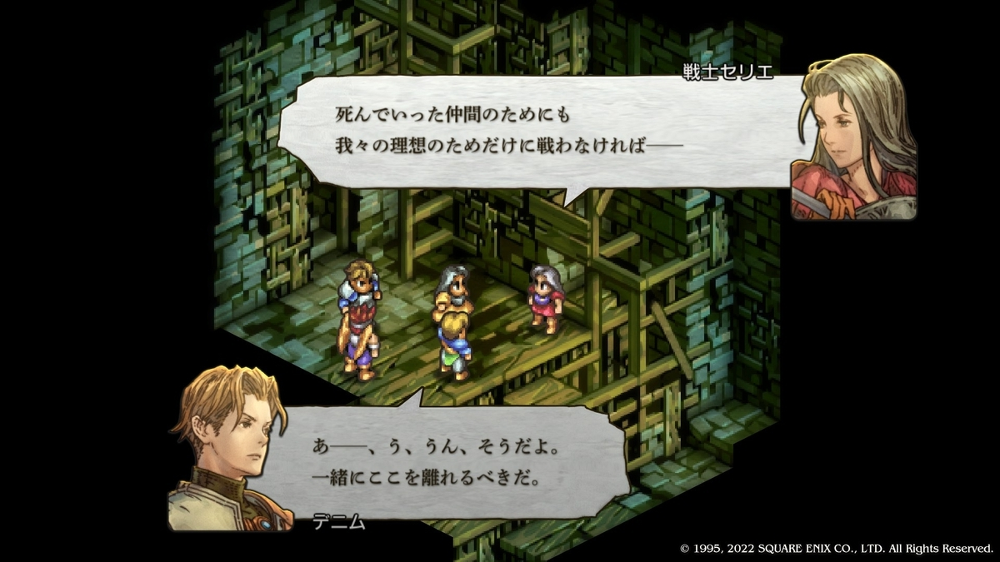
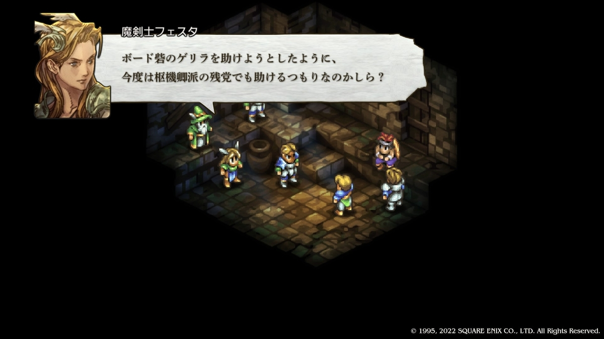
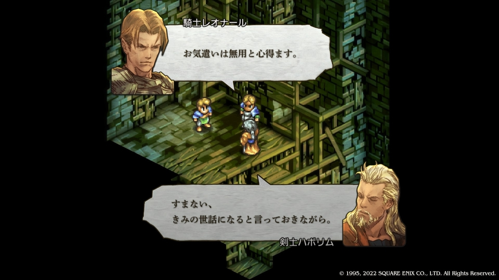
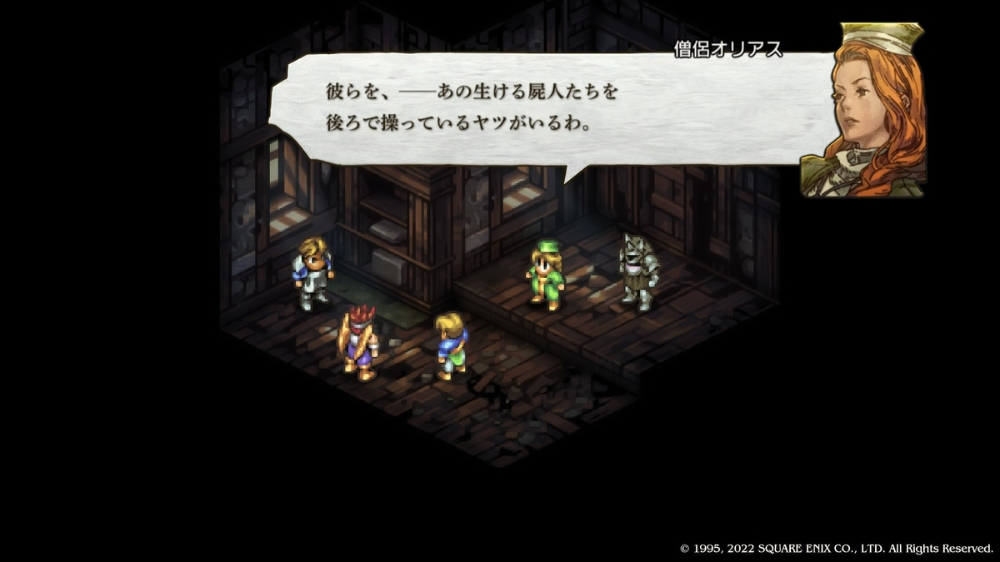
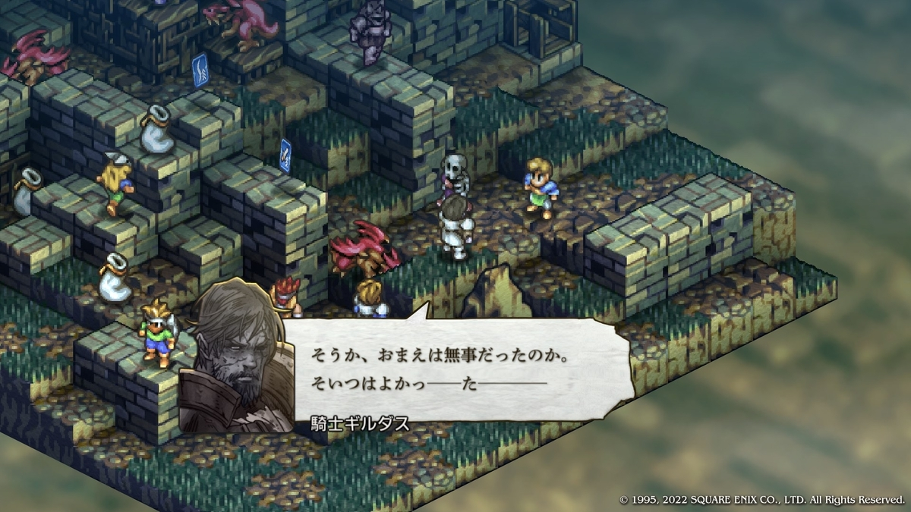
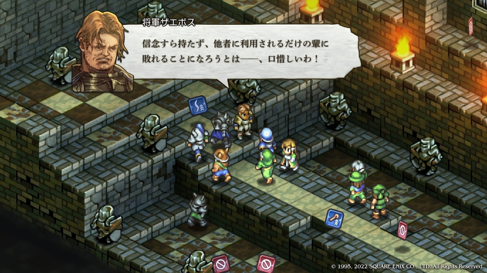
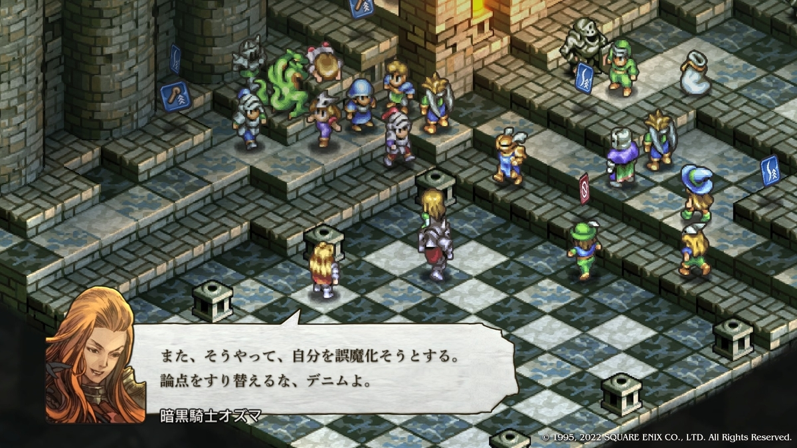

+++
date = '2026-10-14T12:00:00+09:00'
draft = false
title = 'タクティクスオウガリボーン雑記（3）'
+++

2章ではロンウェー公爵軍への復帰を選んだ。Nルートである。

バルマムッサで虐殺を拒否したにもかかわらず、その後は虐殺を主導したロンウェー公爵の下へ戻ることになる。一度は手を汚すことを拒み、その後は虐殺を主導した体制の下で戦うことを選ぶのだから、一見すると一貫性のない行動にも見える。

しかし、虐殺への加担は拒絶するが、遺恨ある勢力に与せざるを得ないとしても外敵と戦い民を守る、と考えれば話は変わる。デニムの指向が「民の命を守ることを最優先とする」のだとしたら、この選択も理解できなくはない。

3章が始まる。

バクラム軍の進軍をウォルスタ解放軍が止めるもそのまま膠着状態になり、暗黒騎士団が沈黙していることで政治的にも膠着状態になっている旨のムービーが流れる。

ムービー終了後、暗黒騎士同士でのこれからの動きについてのやりとりと、公爵からヴァイス追討の指示をデニムが受け入れ、そのことでデニムに対して納得いかなくなったカチュアが退席するシーンなどが表示される。

シーン終了後、唐突にガルガスタン軍兵士の公開処刑という一方的な戦闘をレオナールとデニムで執り行う場面に入り、デニムの動揺やガルガスタン人騎士の死に様を見ることとなる。

マップ移動をしようとするとミルディンとウォーレン（意識不明）に再会する。ミルディンに「ヴァイスくんを見殺しにするつもりはないのでしょ？」と言われ頷くデニム、プレイヤー視点だと「その意思をカチュアにも見せてやって欲しい」と思うものの残念ながらそれが起きることはない。

ミルディン・ウォルホーン。つい注釈を入れたくなる登場人物である。
寡黙なイケメンであり、ゲーム上の性能も高い。しかし私にとって印象的なのは、感情に流されず、騎士として行動する姿が、優秀な軍人像を連想させるところである。

マップを進める前にアロセールの限界まで下がった忠誠度を上げる。SFC版ではNルート選択時に離反していたが、TORではそうならない。「命を預ける」ということがどういうことなのかを考えれば、この変更は妥当に思える。自分の理想と反対の選択をしたからといって、それだけで離反が確定するわけではない。信頼は大きく損なわれるだろうが、それでも共に戦い続けるという選択肢は十分にあり得る。TORのアロセールは、その辺りの人間関係をより現実的に表現しているように感じる。

## ボード砦へ
やや強引だが、暗黒騎士団がボード砦を攻撃するようであり、そこにいるかもしれないヴァイスを救出する。いるかもしれないという可能性だけを頼りに戦いへ向かうのである。

戦闘が始まるとセリエ救出という制約に加え、敵は砦の高所に陣取っており、さらに性能も高い。そのため難しく感じやすいマップである。

飛行ユニットによる移動と、近接攻撃を成立させる支援行動が大きな有利不利を生む。普段通りでもあり、下記のようにTORの仕様でもある。
- 弓が圧倒的に強かったSFCTOとは異なり、TORでは高低差だけで勝敗が決まることは少ない
- 状態異常の付与や移動阻害など、単純なステータスでは測れない要素が戦況へ大きく影響する

バフカードを積んでいないオズと多少の不利、これらを覆せないようではこの先進むことはできない。戦い勝利する。運の良さもあったが運が悪くてもグリフォン2体が戦闘不能になるかもしれない程度のものであった。

戦闘終了後の会話パート。デニムはセリエへ同道を勧めるが断られる。

虐殺の否定や、亡き同志たちと共に追い求めた理想について語る姿を見ると、セリエは現実より理想を重視する人物へ変わったようにも見える。しかし、元々彼女が肯定していたのは暗殺という手段であって、それ以外については語られていなかった。そう考えると、元からそうであったと考えることもできる。

## アルモリカ城へ戻る。
ロンウェー公爵、解放軍騎士、解放軍魔術師、デニムとカチュアの5人での会話シーンが始まる。
1. 軍事的評価と政治的評価の極端な乖離からの違和感が発生する。暗黒騎士団という大国でトップクラスに位置する特殊部隊と遭遇し、その指揮官（オズ）を討ったことが評価されない。
2. ギルダスについての嘲笑で解放軍騎士の人柄に違和感が発生する。会議に参加するレベルの騎士が確たる根拠が無い段階で友軍の騎士（ギルダス）を敵前逃亡したのだろうと侮辱し嘲笑する。

私には、この2点がファンタジー世界のやりとりというより、SFC版発売当時の昭和的な創作で見られた価値観を持ち込んだ会話に見えてしまう。
- デニムがバルマムッサで公爵軍を離反し、その後に復帰したことを快く思っていない人物がいたことの表現
- 政治的な事情から扱いに困る戦果である表現
- ヴァレリア解放戦線を殲滅直後だったことで戦力がある程度減っている表現

これらを含めても「1.」はNPC達が作中で最大級の脅威として認識している暗黒騎士団の部隊の一つと戦い勝利したことを、NPCが政治的な理由による非難だけで終わらせている点に違和感がある。「2.」はステレオタイプのストーリーにおける悪役の台詞に見える。つまり、脚本上の役割を優先した会話に見えてしまう。

##タインマウスの丘を通過時
突如戦闘となりガンプが現れる。ガンプ自身の近接戦闘能力は高く、配下のグリフォン2体とコカトリス2体も自軍の魔獣より高性能である。さらに魔獣が倒されるたびにガンプは回復し、自軍全体へ性能低下のデバフを付与してくる。加えてリザードマンやホークマンも強力であり、単純に厳しい戦闘と言える。

このため、普段行っている状態異常による行動阻害だけでは足りない。ドラグーンで魔獣へのダメージを稼ぎ、魔獣撃破時に付与されるデバフをある程度クリアランスで解除することも求められる。高い移動力、空中移動による地形、ユニットによる壁の無視、状態異常の活用など、普段はこちらが押し付けている強みを敵側からやり返される戦闘でもある。そのため、体感としてはオズ戦よりも厳しく感じる戦いである。

回復アイテムを使い切るユニットも出たが勝利する。ストーリー上の見どころはないものの、その分ガンプ部隊の強さが印象に残るマップであった。

## クリザローの町へ
画面が変わり会話シーンが始まる。

友軍のはずの魔剣士フェスタから「ここに何しに来た、ゲリラの次は敵の残党でも助けるつもりなのか？」「裏切り者のくせに！」と罵倒される。仮にデニムが「その通りだな、ではこの場で私と戦って死ね」と返せば、フェスタに打つ手はない。フェスタの発言は、味方でもあり、デニムが甘い人物であること、何かあってもレオナールが止めてくれることを理解した上でのものでなければならない。

## クァドリガ砦へ向かう。
自軍8対敵軍12で戦闘開始。敵の構成はガンプ戦と大差ない上、今度は戦闘不能のNPCを3ターン以内に復帰させ、その後も守りながら戦わなければならない。戦術面では本作屈指の難マップだと思っている（相手リーダーのボティスがウィザードであることくらいしか救いがない）。

現状、味方にできて敵に出来ないこと
- ドラグーンによる魔獣、ドラゴンの排除
- HP回復アイテムによる大幅な回復

これだけでは復帰させたカモスが敵の空中移動ユニット等によりすぐ倒されることを戦術的に回避できないので、移動力、段差の影響を受けにくい、状態異常付与などから、このマップではニンジャの有用性が高そうなので救出用に採用する。

復帰後のフェスタが無謀な進軍を繰り返すため、グリフォンで壁を作りながら回復する。NPC3名はいずれも戦術上は足を引っ張りやすく、運良く活躍したとしても管理の手間が増える存在であった。それらを抱えたまま勝利する。

戦闘終了後の会話パート。ハボリムとのやり取りが始まる。

ハボリムに「真の敵は暗黒騎士団なのか？」と問われる。Nルートのデニムにとって真の敵は誰なのか、簡単には答えられない問いである。

仮にハボリムがレオナール旗下に入ったらどういう未来となったのだろうか？少し気になるシーンでもある。

## 港町アシュトンへ
それなりに強いNPC2名と共に、リーダーのいないアンデッド部隊を殲滅するだけなので戦術的には簡単すぎて書くことがない。

冒頭に様子のおかしいギルダスが現れ立ち去る。そして戦闘終了後、助けたオリアスからギルダスが既にアンデッドであることを告げられる。デニムは動揺する。ミルディンは一度カノープスへ顔を向けるだけで無言である。カノープスも終始無言である。

ミルディンの反応は以前書いた通り軍人らしいものである。しかし印象的なのはカノープスもまた同じであったことだ。ウォーレンレポートでは「デニムらを実の弟のように可愛がっている」と記されている人物であるが、この場面では無言である。戦士としての側面が表現された場面と考えることができる。

注釈として、カノープスは外見こそ20代に見えるものの、有翼人であるため実年齢は48歳である。前作での登場時点でそれ以前からの戦士として扱われている。

## 部隊の再編
ユニオンレベルが上がったので「フレイムドラゴンを入れて火山で活躍させてみたくなった」だけの、戦略上あまり必要とは言えない部隊の再編を行う。
- フレイムドラゴン3体を仲間にする
- フェアリーをマスコットとして仲間にする
- mod導入によりこの時点で仲間にできるグレムリンを仲間にする
- mod導入により転職証が手に入るローグを仲間にする

名前は以下の通り。
- フレイムドラゴン1　→　リンドドレイク
- フレイムドラゴン2　→　アズダハー
- フレイムドラゴン3　→　ケツァルコアトル
- フェアリー　→　パック
- グレムリン　→　ギズモ
- ローグ　→　マーキュリー

ここまでやってきて、このmodにおけるルインハーツの命中補正が高すぎることに気づく。演習でニンジャに正面から通常攻撃した場合の命中率は62%だったが、ルインハーツは100%であった。フランパ大森林でも通常攻撃が44%だったのに対し、ルインハーツは100%になったことがある。正面からの攻撃はある程度の回避できる環境において、Lv.10で習得する必殺技がそれを覆してしまうのである。他の必殺技や他の仕様について事細かに調査した訳でもなんでもないが、この仕様で楽しくゲームを続けられるか考える必要が生まれた。modのバージョンを確認したが、使用中のものより新しいバージョンは存在しないようであった。

選択肢は下記のようになっている。

1. 槍を使わない
2. ルインハーツを使わない
3. 特定の条件下（正面からの攻撃等）でルインハーツを使わない

とりあえず3.でやってみてダメそうだったら2.にしてみるか、くらいに考える。

## ヘドン山へ
フレイムドラゴンを活躍させて戦闘が終わる。開幕と終了時少し台詞があるのみで終わる。

## バンハムーバの神殿へ向かう。
開幕と終了時少し台詞があるのみで終わる。

## ダムサ砦へ向かう。
カノープスとミルディンを出撃メンバーに入れて戦いを始める。

開幕シーンがストーリーとして絶望的である。そして始まる戦いもバフカード4枚を持ったニバスが高所から魔法で攻撃してくる。さらにアンデッドの集団、数を減らせば使われるサモンダークネス、そして飛び抜けて強い敵となったギルダスがいる。

さらにカノープスとミルディンの台詞を見るために時間稼ぎもしなければならない。何も考えずに戦ってどうにかなるものではない。

ドラゴンで攻撃を受け、回復アイテムで支えるというダメージコントロールや今までのセオリーの行動を取り勝利する。

誰よりも騎士らしい男。

ワールドマップへ戻るところで「プリンセス・カチュア」のシーンが流れる。内容はどのルートでも共通である。デニムのことを思案していたカチュアの前にランスロット・タルタロスが現れ、その生い立ちを説明した後に連れていく。

## アルモリカ城へ
ロンウェー公爵から、コリタニ城に陣取るガルガスタン軍残党の殲滅とライム奪還を命じられる。この場面のロンウェー公爵はかなり強気であり、戦意に満ちた発言をしている。しかし、その変化の理由までは分からない。指揮下のデニムが暗黒騎士団とも戦える戦力へ成長したことや、今後の展望に勝機を見出したのかもしれないが、作中では語られていない。

## コリタニ城城門前へ
戦闘については堀を越えて片翼を崩せば大勢は決まり勝利する。

倒した敵リーダーについてウォーレンレポートを見ると、「極右の歴史家」「ガルガスタン至上主義」「特権意識」と不穏な単語が並んでいた。とはいえニバスやガンプのように手強い上で逃走する相手でもない。あっけない最期である。

## コリタニ城城内へ
バフカード4枚を持つザエボスと配下12名。前のマップよりは手応えがあるものの、それでもニバスよりは楽に感じてしまう。デニム＋汎用11名で戦うことにする。運任せの部分もあるが、ファランクスやビゴラスアタック等を駆使して勝利する。

他ルートでは印象的な台詞が多いザエボスだが、Nルートのデニムにはいまいち刺さらない。

Nルートのデニムは、自らを裏切り者と罵る者をも助ける男である。仮にザエボスが聖人君子であり、それらしいことを言ったとしても効くことはないだろうと思わせる。

## ウェオブリ山へ
開幕と終了時少し台詞があるのみで終わる。

## 古都ライムへ
ロンウェー公爵、レオナール、他騎士達により暗黒騎士バールゼフォンを捕らえたところから始まる。バールゼフォンの台詞は騎士というより政治家色が強いなとか考えつつシーンを進め、戦闘を開始する。戦闘開始時オズマが現れるも何もせず撤退、リーダーなしのバクラム軍を距離が近い順に倒して終わる。全てがうまくいくかとも思われたが、バールゼフォンはオズマに奪還されロンウェー公爵はヴァイスに暗殺され、ヴァイスもまたその場で殺された。

ロンウェー公爵が何を考え戦意高揚していたのかを知りたかったがその機会はもうなさそうだ。

## アルモリカ城へ戻る。
レオナールの演説が行われる。内容はともかくとして、ロンウェー公爵という指導者を失ってもなお、責任を果たそうとする姿勢が崩れることはない。戦いや犠牲、納得できないものを含め多くの事象の上で今が成り立っており、信じる未来へ進むことをやめない。レオナールはこれらを行動で語っているかのように見える。

真にレオナールは、理想を実現するためなら手段を選ばない人物であり、そういう意味では私にとってデニムより英雄や救世主に近く感じる人物である。

## フィダック城へ
フィダック城西で戦闘を開始する。NPCはゴーレムによる足止めと高所からの弓攻撃という理想的な戦術を行うが決定打がない戦い方であり、優秀なアイアンゴーレムを自軍に欲しいと余計なことを考えつつ圧勝して終わる。

オズマとバールゼフォンの会話シーンが入る。

フィダック城城内で戦闘を開始しようとするとレオナールがカチュアの不意打ちで死ぬ。ストーリーの展開を考えると仕方ないがかなり強引である。しかし昔から指摘されてるであろうことなのでここでは細かい話をしないこととする。

もしここにレオナールの配下になっていた世界線のハボリムがいてその武器を弾き飛ばしていたらと思わざるを得ない。

戦闘については、敵リーダーはオズマであり、バフカード4枚の暗黒騎士という分かりやすい脅威である。氷エレメントであり、自軍で活躍するカノープス等風エレメントユニットを容易に刈り取る。慢心していない暗黒騎士が強いことを表現しているとも言える。しかし、火エレメントで対抗すれば良いだけとも言える。

フレイムドラゴンを使っても良かったが、今回は序盤から使い続けている火エレメントの格闘ウォリアー（烈火掌）で対抗することにした。

戦闘中雄弁に語るオズマだが、その内容は挑発に近いものであり、時間稼ぎの囮らしいと言えばそれらしいものであった。オズマは負けることを理解している。生きて帰ることが難しい状況で武人として死ぬことを選択するのは非難できるものなのであろうか、難しいところではある。

章題は「すくいきれないもの」である。多くのものを救うことも、掬うことも、済うこともできなかった章であったと言えるだろう。

最後に、ここまでの戦闘でチャームがいくらか溜まっているが取り扱いには注意する必要がある。このゲームの取り返しがつかない部分として「デニムをチャームで強くすると元に戻すことができない」という点がある。一見何も問題ないように見えるが強化しすぎたデニムはゲーム性を破壊するため、多くの戦闘が無味になることがありえることを理解しておかないと後悔することもあるかもしれない。